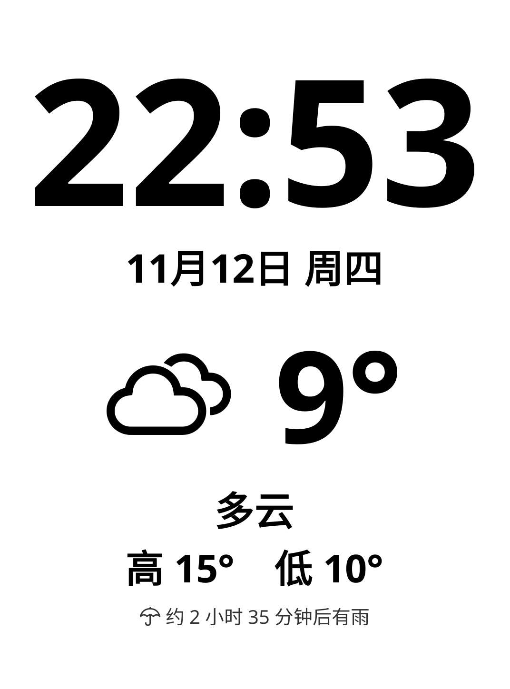

# WallDash for Kindle

[简体中文](README.md)

Give an old Kindle Paperwhite 4 a place on the wall as a glanceable e-ink clock and weather display. WallDash runs in KOReader on an already jailbroken device. Swipe through current conditions, a 24-hour temperature and precipitation chart, a seven-day forecast, and details such as wind, UV, air quality, and moon phase.

## Compatibility

WallDash supports the **Kindle Paperwhite 4 (10th generation, 2018)**. The tested configuration is firmware **5.18.1** with KOReader **2026.07.2** (`kindlehf`). Use KOReader's SDL build for [desktop UI testing](CONTRIBUTING.md#ui-and-hardware-testing).

## Install

1. Install [KOReader](https://github.com/koreader/koreader/wiki/Installation-on-Kindle-devices) on an already jailbroken PW4 and open it once.
2. Quit KOReader and connect the Kindle via USB. Unzip the plugin ZIP from [Releases](https://github.com/Guoyuer/walldash-for-kindle/releases), or clone this repository. Copy the entire `deskdash.koplugin` directory into `koreader/plugins/` on the Kindle drive. The resulting path is `koreader/plugins/deskdash.koplugin/main.lua`.
3. Safely eject the Kindle, connect it to Wi-Fi, and open KOReader from the library. WallDash opens automatically by default. To open it manually, use **Tools → WallDash → Open dashboard**.

To update or uninstall, quit KOReader, then replace or remove the plugin directory. After uninstalling, re-enable **Auto suspend** in KOReader's plugin management and restart KOReader.

## Use

- Swipe left or right to change pages, tap to refresh the weather, or long-press to return to KOReader. With automatic opening enabled, WallDash reopens after about five idle minutes in the file browser. Forecast pages return to the clock after about two minutes of inactivity.
- The gear on pages 2–4 controls language, clock format, units, and orientation.
- Battery mode is on by default. On battery, the idle clock page wakes and updates once a minute, or every 10 minutes from 2 to 5 a.m. local time. Press the power button for roughly a minute of interaction. Scheduled weather updates usually run hourly on battery and every 15 minutes on external power. They pause from 2 to 5 a.m. on either power source.
- Use **Tools → WallDash** to turn off automatic opening or battery mode. On the PW4, WallDash marks KOReader's Auto suspend disabled from the next KOReader start, including when WallDash battery mode is off.

## Weather data and privacy

By default, [ip-api](https://ip-api.com/docs/api:json) infers an approximate location from your public IP over HTTP. WallDash processes and displays forecast, nowcast, and air-quality data from [Open-Meteo](https://open-meteo.com/). US station observations and alerts come from the [National Weather Service](https://www.weather.gov/documentation/services-web-api). Requests to the weather providers include latitude and longitude.

You can [set a fixed location](docs/weather-accuracy.md#fixed-location) to skip the IP lookup.

Open-Meteo data is licensed under [CC BY 4.0](https://creativecommons.org/licenses/by/4.0/). The plugin uses its free hosted endpoint, which is available for non-commercial use under the [Open-Meteo terms](https://open-meteo.com/en/terms).

See [CONTRIBUTING.md](CONTRIBUTING.md) for offline checks, the KOReader emulator, and optional device tools. The project source is licensed under [GNU AGPL v3](LICENSE).
