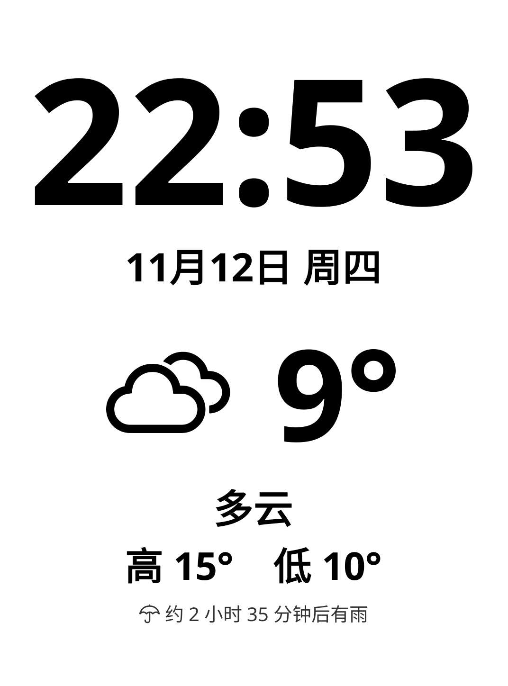

# DeskDash for Kindle

[English](README.en.md)

把越狱后的 Kindle Paperwhite 4 变成挂墙的墨水屏时钟和天气面板。四页分别显示当前天气、24 小时温度和降水概率、7 天预报，以及风、紫外线、空气质量和月相等详情。

## 支持范围

实机基线为 **Kindle Paperwhite 4（第 10 代，2018）**、固件 **5.18.1**、KOReader **2026.07.2**（`kindlehf`）。当前只在 PW4 和 KOReader 的桌面 SDL 环境加载插件。桌面环境用于检查界面，RTC、前光和功耗需要在实机验证。

## 安装

1. 在已越狱的 PW4 上安装并运行一次 [KOReader](https://github.com/koreader/koreader/wiki/Installation-on-Kindle-devices)。
2. 退出 KOReader，用 USB 把 Kindle 连到电脑。下载或克隆本仓库，把整个 `deskdash.koplugin` 文件夹复制到 Kindle USB 盘的 `koreader/plugins/` 下。确认最终路径为 `koreader/plugins/deskdash.koplugin/main.lua`。
3. 安全弹出 Kindle，连上 Wi-Fi，再从书库打开 KOReader。DeskDash 默认自动打开。也可以在 KOReader 的 **工具 → Desk dashboard → Open dashboard** 打开。

日常使用只需复制插件目录。Jobman、SSH 和 Python 是可选的开发工具。更新时先退出 KOReader，再替换插件目录。卸载时退出 KOReader 并删除插件目录。如需恢复 KOReader 的自动休眠，在其插件管理里重新启用 **Auto suspend** 并重启 KOReader。

## 操作与电池模式

- 左右滑动翻页，轻点刷新天气，长按返回 KOReader。文件管理器闲置 5 分钟后自动回到仪表盘。
- 第 2–4 页右下角的齿轮可切换中文或 English、12 或 24 小时制、摄氏或华氏，以及横屏或竖屏。
- **电池模式默认开启。** 拔电后，首页每分钟更新一次，然后进入休眠。按电源键唤醒可操作约 60 秒。凌晨 2–5 点每 10 分钟更新时钟，暂停获取天气。白天电池供电时通常每小时更新天气，插电时每 15 分钟更新。
- 在 KOReader 的 **工具 → Desk dashboard** 可关闭自动打开或电池模式。插件会把 KOReader 的 Auto suspend 标为禁用，从下一次启动生效，避免两套休眠逻辑同时运行。

## 天气数据与隐私

默认通过 [ip-api](https://ip-api.com/docs/api:json) 的 HTTP 接口按公网 IP 查找大致位置。预报、降水临近预报和 AQI 由 [Open-Meteo](https://open-meteo.com/) 提供并经 DeskDash 整理展示。美国境内的气象站实况和预警来自 [美国国家气象局](https://www.weather.gov/documentation/services-web-api)。天气请求会向对应服务发送经纬度。

如需固定位置，退出 KOReader 后在 `koreader/settings.reader.lua` 的设置表内添加 `["deskdash_lat"] = 40.7829,` 和 `["deskdash_lon"] = -73.9654,`，把示例换成目标位置。也可加 `["deskdash_city"] = "New York",` 作为显示名称。经纬度都已设置时跳过 IP 定位。

Open-Meteo 数据采用 [CC BY 4.0](https://creativecommons.org/licenses/by/4.0/)。项目默认使用仅供非商业用途的免费 API，详见 [Open-Meteo 服务条款](https://open-meteo.com/en/terms)。

## 开发与贡献

参见 [贡献指南](CONTRIBUTING.md)、[性能测试](docs/performance-benchmarks.md)和[天气数据比较](docs/weather-accuracy.md)。项目源码采用 [GNU AGPL v3](LICENSE)。
